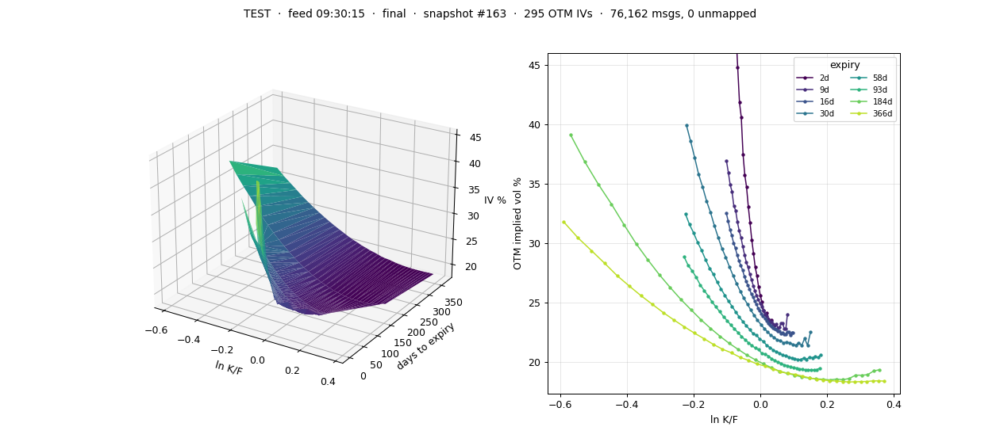

# Volatility Field

A live implied-volatility surface kept in GPU memory and fed straight from the
exchange feed: Nasdaq BONO top-of-book options quotes (spec v3.3, over
MoldUDP64) are parsed on the GPU by the threads that receive them, every
two-sided quote updates its option's state and implied vol in VRAM, and a
surface pass running next to them publishes a consistent snapshot into shared
memory, which the GPU writes directly

## The math

Black-76 on the forward (`include/vf/black.hpp`), in `double` on host and
device:

```math
d_1 = \frac{\ln(F/K)}{\sigma\sqrt{T}} + \tfrac{1}{2}\sigma\sqrt{T}, \qquad d_2 = d_1 - \sigma\sqrt{T}
```

```math
C = e^{-rT}\left[F\,N(d_1) - K\,N(d_2)\right], \qquad P = e^{-rT}\left[K\,N(-d_2) - F\,N(-d_1)\right]
```

```math
\mathcal{V} = \frac{\partial C}{\partial \sigma} = e^{-rT}\,F\,\varphi(d_1)\sqrt{T}
```

The forward comes from put-call parity, not spot, so dividends and borrow are
already in it: each strike with both mids gives

```math
F_i = K_i + e^{rT}\,(C_i - P_i)
```

and the median over the 5 pairs with the smallest $|C_i - P_i|$ is the
expiry's forward. $r$ is `--rate`; $T$ is in 365-day years to 16:00 ET on the
expiry date, floored at one minute. Implied vol is solved on the
out-of-the-money side (Corrado-Miller start, bracketed Newton with a bisection
fallback), and the surface uses OTM options only, since a European model on
American prices is biased in the money.




Two binaries run the same per-frame kernel code and differ only in where
frames come from:

| binary | frames from | status |
|---|---|---|
| `vf_sim` | a pcap replay or UDP socket, copied into a VRAM ring | runs on any sm_75+ GPU; tested on a GTX 1650 |
| `vf_gpunetio` | the NIC, straight into VRAM (DOCA GPUNetIO) | needs a ConnectX-6 Dx or newer; compile-verified only |

## Quick start

Needs CUDA 12.2+, CMake 3.25+, a C++17 compiler and an sm_75+ GPU; the Python
tools need numpy and matplotlib.

```sh
cmake --preset dev && cmake --build --preset dev -j && ctest --preset dev

python3 tools/bono_gen.py --out out/chain.pcap --date 2026-10-20     # synthetic chain + truth
build/dev/vf_sim --pcap out/chain.pcap --underlying TEST --date 2026-10-20 --rate 0.04 \
    --snapshot-ms 100 --duration 20000 &
python3 tools/plot_surface.py                                          # live window
python3 tools/check_surface.py --truth out/chain.truth.csv            # after the run: PASS / FAIL
```

`tools/live_surface.py` draws the same surface at 60 fps (needs PySide6).

## Status

* Everything so far runs on synthetic feeds from `tools/bono_gen.py`; no real
  BONO capture has been through it yet.
* GTX 1650: the end-to-end check passes (every OTM IV within its quote's
  spread), at up to 3.1M messages/s on one queue unpaced.
* The WATcloud jobs are written but not yet run.
* No gap recovery or Glimpse: a run must start before the start-of-day
  directory messages.


## Docs

* [Building and running](docs/running.md) - presets, `vf_sim` flags, UDP, the
  60 fps viewer, remote plotting, WATcloud, real hardware
* [Design](docs/design.md) - how a quote becomes a point on the surface, the
  math, design notes, limitations, source layout
* [Results](docs/results.md) - accuracy and throughput, and how to read them
