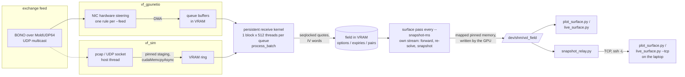

# vol_field

A live implied-volatility surface kept in GPU memory and fed straight from the
exchange feed: Nasdaq BONO top-of-book options quotes (spec v3.3, over
MoldUDP64) are parsed on the GPU by the threads that receive them, every
two-sided quote updates its option's state and implied vol in VRAM, and a
surface pass running next to them publishes a consistent snapshot into shared
memory, which the GPU writes directly - no host thread copies the data.
`tools/plot_surface.py` draws it live, and `tools/live_surface.py` draws it at
the display's refresh rate.

There are two binaries, and they differ only in where frames come from.

**`vf_gpunetio` - NIC -> VRAM (DOCA GPUNetIO).** The NIC's hardware steering
sends the BONO multicast groups into packet buffers in GPU memory, and a
persistent kernel (one block per receive queue) parses them in place. No CPU
thread is on the data path. Needs a ConnectX-6 Dx or newer, so it is **built
and compile-verified against DOCA 3.5, not yet run** - nobody here has the
NIC.

**`vf_sim` - the same kernel body on any sm_75+ GPU.** A host thread replays a
pcap (or receives UDP datagrams) into a VRAM ring, and a persistent kernel of
the same shape runs the same per-frame code (`vf::dev::process_batch`, in
`include/vf/field_device.cuh`) over it. This is the path that runs and is
measured: the laptop (GTX 1650) and WATcloud (2080 Ti / 3090 / 4090).


## How a quote becomes a point on the surface



**Per batch** (up to 1024 frames, 512 threads, two frames each), in
`process_batch`:

1. Each thread checks Ethernet / IPv4 / UDP (one VLAN tag allowed), then walks
   its frame's MoldUDP64 blocks; every message gets the 64-bit sequence
   number `mold seq + index`.
2. **Pass 1** - Timestamp (`T`, folded into the feed clock with `atomicMax`),
   System Event, and the Options Directory (`D`), which claims slots in three
   lock-free open-addressing tables: options by ID, expiries by
   (underlying, YYMMDD), strike pairs by (expiry, strike). Only `--underlying`
   symbols are mapped.
3. `__syncthreads()` - so a directory entry and a quote for it in the same
   batch always apply in that order.
4. **Pass 2** - quotes (`q Q b a B A`), Trading Action (`H`), Security Open
   (`O`). A quote takes its option's seqlock with a CAS spin, applies each side
   only if its message sequence is newer than the one stored for that side,
   and releases. A newer quote that got there first, or an A/B-feed duplicate,
   simply applies nothing (counted as *stale*). The thread then solves the IV
   - outside the lock - if the option is live, two-sided, the expiry has a
   forward, and the option is out of the money, and publishes it as a 64-bit
   word `quote version << 32 | float IV` with a CAS that never replaces a
   newer version.

**Every `--snapshot-ms`** the host launches the surface pass on a second,
non-blocking stream while the receive kernel keeps running:

1. *forward* - one block per expiry: the parity forward
   `K + e^{rT}(C - P)`, median over the 5 pairs with the smallest `|C - P|`,
   reading each quote under its seqlock;
2. *resolve* - every option's IV re-solved against that forward (so IVs
   follow the forward, and ITM options get one too), published with the same
   version rule;
3. *snapshot* - three kernels on one stream: seqlock odd, write records,
   header and seqlock even with `__threadfence_system()`, into pinned shared
   memory registered with `cudaHostRegisterMapped`.

Readers (`tools/vfsnap.py`) copy between two equal, even seqlock reads.

**The math** (`include/vf/black.hpp`, `double`, host and device): Black-76 on
the forward; implied vol from the out-of-the-money side's time value with a
Corrado-Miller (else Brenner-Subrahmanyam) start and bracketed Newton with a
bisection fallback, NaN when the price is outside the no-arbitrage bounds or
a side is missing. Time to expiry runs to 16:00 ET on the expiry date from the
feed clock, floored at one minute; `--date` and `--rate` are inputs. The
surface uses OTM options only: puts below the forward, calls above.

## Build

Requirements: CUDA 12.2+, CMake 3.25+, a C++17 host compiler, and an sm_75+
GPU to run anything. Tested with CUDA 13.4 / gcc 16 on the laptop, 13.0 in the
DOCA container, and 12.2 / gcc 11.3 (`nvidia/cuda:12.2.2-devel-rockylinux9`,
the version WATcloud's CVMFS stack provides): the `watcloud` preset builds
without warnings there, and its tests and an end-to-end check pass on the
laptop GPU. Configuring for anything older than sm_75 is a configure error:
the per-option seqlock spins on a CAS and needs independent thread scheduling.
The Python tools need numpy and matplotlib (`bono_gen.py` and
`replay_pcap.py send-udp` need nothing beyond the standard library);
`live_surface.py` needs PySide6 with QtGraphs, Qt 6.8+ (Fedora:
`python3-pyside6`) instead of matplotlib.

```sh
cmake --preset dev              # vf_sim + tests, for this machine's GPU
cmake --build --preset dev -j
ctest --preset dev              # bono, black, field
```

| preset | builds | for |
|---|---|---|
| `dev` | vf_sim, tests | the GPU in this machine (`native`) |
| `debug` | same, `-O0 -g` | |
| `watcloud` | vf_sim, tests | sm_75;86;89 - every WATcloud GPU; configures on a login node with no GPU |
| `gpunetio` | vf_gpunetio only | inside the DOCA container (`scripts/doca-build.sh`) |

**vf_gpunetio** needs the DOCA SDK, which has no Fedora build:

```sh
scripts/doca-build.sh           # pulls nvcr.io/nvidia/doca/doca:devel-cuda13.0.0-3.5.0-devel-host once
```

builds `build/gpunetio/vf_gpunetio` against DOCA 3.5 / CUDA 13.0 in the
container, then smoke-tests it there: with no NIC it must stop cleanly at
`no DOCA device at PCI ...`.

## Run

### On the laptop

```sh
python3 tools/bono_gen.py --out out/chain.pcap --date 2026-10-20     # + out/chain.truth.csv
build/dev/vf_sim --pcap out/chain.pcap --underlying TEST --date 2026-10-20 --rate 0.04 \
    --snapshot-ms 100 --duration 20000 &
python3 tools/plot_surface.py                                          # live window
python3 tools/check_surface.py --truth out/chain.truth.csv            # after the run: PASS / FAIL
```

`bono_gen.py` writes one synthetic underlying's chain (default 8 expiries x 41
strikes x C/P) exactly as Nasdaq frames it: a pre-open with the directory
spin, Trading Action and Security Open, then 15 s of quoting at 10 steps/s -
random-walk spot, a Black-76 smile whose level, front end, skew and curvature
drift as smooth mean-reverting factors (`--motion` scales them, 0 holds the
smile still), theo +- a spread rounded to the minimum price variation, several
messages per packet, a heartbeat each second, end-of-session. Up to 28
expiries (past 11: weeklies, monthlies and LEAPS) and any odd number of
strikes. `--dup` sends every packet on an A and a B feed; `--halt`
halts one option mid-session. The truth file has the volatility and forward
every quote was priced from, and `check_surface.py` compares a snapshot
against it: forwards within 1e-3 relative, OTM IVs within the spread the quote
itself admits, coverage, and the counters (unmapped = 0, IV failures under
0.1%, no table overflow).

`vf_sim` frame sources and pacing:

| flag | |
|---|---|
| `--pcap FILE` | replay a classic Ethernet pcap (pcapng: `editcap -F pcap`) |
| `--realtime`, `--speed X` | pace by capture timestamps (the default), X times faster |
| `--pps N` | N frames/s; `--pps 0` is unpaced: as fast as the GPU takes them |
| `--loop` | replay forever, moving MoldUDP64 sequence numbers up one lap's span per lap |
| `--feed G:P[,..]` | only frames to these destinations |
| `--udp G:P[,..]` | receive datagrams instead (multicast groups are joined; `--udp-iface IP`) |
| `--queues N` | receive blocks; frames hash to a queue by destination, like RSS |
| `--backoff NS` | `__nanosleep` while the ring is empty, instead of spinning |

and the common run flags: `--underlying SYM[,..]` (up to 8), `--date`,
`--rate`, `--duration MS` (0 = until Ctrl-C), `--snapshot-ms`, `--shm NAME`
(or a path on any tmpfs), `--verbose`.

The GTX 1650 in the laptop also drives the display, so it has a kernel
run-time watchdog: keep `--duration` to a few tens of seconds there.

**UDP**, e.g. from another host (no root, no scapy):

```sh
build/dev/vf_sim --udp 233.54.12.111:18001 --underlying TEST --date 2026-10-20 --rate 0.04
tools/replay_pcap.py send-udp --pcap out/chain.pcap --pps 20000 --loop 2      # sender
```

**60 fps**: `tools/live_surface.py` draws the same snapshot in a Qt Quick 3D
window refilled every vsync - one row per expiry, one column per OTM point,
the wireframe showing where the points are - and interpolates between
snapshots, a frame or two behind the newest, so the surface moves on every
frame. Feed it a dense chain re-quoted 60 times a second and snapshot often:

```sh
python3 tools/bono_gen.py --out out/live.pcap --date 2026-10-20 --expiries 22 --strikes 81 \
    --seconds 20 --steps 60 --no-truth                                 # 3558 options, ~2M messages
build/dev/vf_sim --pcap out/live.pcap --underlying TEST --date 2026-10-20 --rate 0.04 \
    --snapshot-ms 8 --duration 25000 &
python3 tools/live_surface.py                                          # drag to rotate, wheel to zoom
```

On the GTX 1650 that holds 60 fps about 40 ms behind the feed, at ~110k
messages/s with every 8 ms surface pass on time.

**Remote plot**: `tools/snapshot_relay.py --port 7700` next to the run serves
each new snapshot over TCP; `python3 tools/plot_surface.py --tcp localhost:7700`
(or `live_surface.py`, with the relay at `--hz 120`) through an `ssh -L`
tunnel draws it. `plot_surface.py --save DIR --frames N` renders PNGs instead
of a window (headless jobs).

### On WATcloud

Nodes are headless SLURM nodes without a CUDA toolkit or root;
`scripts/watcloud/env.sh` loads gcc, CUDA 12.2, cmake and Python
(scipy-stack) from the Alliance CVMFS stack and points the loader at the
node's driver.

```sh
ssh wato-login
cd vol_field && source scripts/watcloud/env.sh
cmake --preset watcloud && cmake --build --preset watcloud -j 8     # login node is fine
sbatch scripts/watcloud/job.sbatch                                  # functional (shard of any GPU)
sbatch --gres gpu:rtx_3090:1 scripts/watcloud/job.sbatch bench      # whole GPU, named
sbatch --gres gpu:rtx_2080_ti:1 scripts/watcloud/job.sbatch bench
sbatch --gres gpu:rtx_4090:1 scripts/watcloud/job.sbatch bench
sbatch --nodes 2 scripts/watcloud/job.sbatch udp                    # vf_sim --udp <- send-udp
sbatch scripts/watcloud/job.sbatch live                             # then, on the laptop:
#   ssh -N -L 7700:<node>:7700 wato-login     (the job log prints the line)
#   python3 tools/live_surface.py --tcp localhost:7700
```

| mode | does |
|---|---|
| `functional` | ctest; realtime run with PNG frames and `check_surface`; A+B feed over 4 queues, checked |
| `bench` | unpaced `--pps 0 --loop` runs: 656- and 2200-option chains on one queue, the 2200 A+B chain on two; table in `bench.md` |
| `live` | `--loop` replay of a 22-expiry chain at 60 steps/s for 25 min, snapshot every 8 ms, `snapshot_relay.py --hz 120` on port 7700 |
| `udp` | `vf_sim --udp` on node 1, `send-udp` from node 2, checked |

Everything lands in `out/watcloud/<jobid>/`. The GTX 1080 node is sm_61:
`vf_sim` refuses it, so name a GPU type when it matters.

### On real hardware (vf_gpunetio)

```sh
scripts/hw-preflight.sh --feed 233.54.12.111:18001   # read-only checks + the command line
sudo build/gpunetio/vf_gpunetio --nic 0000:c1:00.0 --gpu 0000:01:00.0 \
    --feed 233.54.12.111:18001,233.54.12.112:18002 --underlying SPY,QQQ --date 2026-10-20 --rate 0.04
python3 tools/plot_surface.py
```

`hw-preflight.sh` checks the kernel (>= 6.2 for dmabuf), the NVIDIA open
kernel modules or `nvidia_peermem`, sm_75+ and BAR1, a ConnectX-6 Dx / -7 or
BlueField-2/3 with Ethernet link type, DOCA's view of it, the NIC/GPU PCIe
topology and NUMA nodes, and picks the best pair. `vf_gpunetio` installs one
root-pipe entry per `--feed` (destination group and UDP port; `:PORT` for any
address), RSS over `--queues` receive queues, and joins the multicast groups
on the NIC's netdev from plain sockets so the switch forwards them; anything
not matched (IGMP, ssh) still reaches the kernel stack. To feed it from a
second host: `sudo tools/replay_pcap.py send --pcap chain.pcap --iface <tx>`.

## Results

Laptop: GTX 1650 (sm_75, 16 SMs, FP64 at 1/32), CUDA 13.4, driver 615.78.

**End to end** (`bono_gen` defaults: 656 options, 8 expiries 2 d - 1 y, 15 s,
76,162 messages in 1,234 packets; realtime, 1 queue, 100 ms snapshots):

| | |
|---|---|
| messages / quotes | 76,162 / 74,174, 0 malformed, 0 unmapped, 0 stale |
| IV on tick | 28,053 solved, 0 failed |
| surface pass | 0.41 ms GPU average (forward + re-solve 656 options + snapshot) |
| forward error | <= 1.3e-4 relative on every expiry |
| OTM IV error | median 3.2e-4 (vol points / 100) vs a median spread bound of 3.5e-3; 301 / 301 points inside their bound |
| `check_surface.py` | PASS |

The same check passes for the A+B duplicated feed over 4 queues (exactly half
the quotes stale, the two feeds racing on the same options from two blocks),
for two laps over UDP sockets via `send-udp`, and for an unpaced single pass
(the whole pcap in two batches: the final state is identical).

**Throughput** (`job.sbatch bench`: unpaced, looped, 20 s per run; msg/s
counts every BONO message, quotes being ~97% of them):

| GPU | feed | queues | msg/s | quotes stale | IV on tick/s | surface pass avg / max |
|---|---|---|---|---|---|---|
| GTX 1650 | 656 options | 1 | 3.14M | 87.3% | 135k | 0.41 / 0.93 ms |
| GTX 1650 | 2200 options | 1 | 2.16M | 70.5% | 194k | 0.54 / 0.70 ms |
| GTX 1650 | 2200 options, A+B | 2 | 7.59M | 85.2% | 353k | 0.57 / 1.28 ms |

On WATcloud: **not run yet** - the login nodes were unreachable from the
network this was built on (port 22 timed out). The job script was exercised
end to end on the laptop with the `dev` preset in place of CVMFS; the first
`bench` jobs on the 2080 Ti, 3090 and 4090 fill in this table.

Reading the numbers:

* One receive block runs on one SM. Two queues on the A+B feed carry 3.5x the
  single-queue message rate: two SMs, and half the messages are duplicates
  that stop at the seqlock without an IV solve. Real BONO is spread over many
  multicast groups, and RSS spreads those over queues.
* "Stale" is high when unpaced: a 1024-frame batch holds most of a lap of the
  synthetic chain, so each option gets dozens of updates in one batch, and
  only those that beat the newest already applied count as applied. That is
  coalescing, not loss - the unpaced check above ends in exactly the truth.
* The on-tick IV solve (`double`, a few Newton steps around `erfc`) is the
  most expensive step per quote, and consumer GPUs run FP64 at 1/32 (Turing)
  or 1/64 (Ampere, Ada) of FP32. Throughput drops once the first surface pass
  provides forwards and on-tick solving starts.
* Contention is the synthetic worst case: 656 - 2200 options with a dozen
  updates per option per second each; a real chain spreads the same message
  rate over far more options.

## Design notes and deviations

* **H and O are applied in pass 2, not pass 1.** A Trading Action racing a
  Directory message for the same option in one batch could hit the option
  before it existed; pass 2 runs after the barrier, like the quotes.
* **On-tick IV is solved for the OTM side only.** Deep-ITM mids at or below
  intrinsic are frequent (wide spreads, penny ticks) and their IVs are not
  used by the surface; solving them on every tick produced ~5% "failures". The
  surface pass still re-solves every option, ITM included, each snapshot.
* **Options start halted** until a Trading Action `H 'T'` releases them:
  the spec sends one per option in the pre-open spin and says an option
  missing from it is to be treated as halted (section 4.4). An option halted
  mid-day shows NaN.
* **The surface kernels are loaded before the persistent kernel starts.**
  With CUDA's lazy module loading, the first launch of a not-yet-loaded kernel
  waits for the device to idle - which a persistent kernel never does; the
  first surface pass then stalled until the run ended. `field_create` forces
  the load with `cudaFuncGetAttributes`.
* **Spec errata** in the v3.3 Appendix A, where `tests/test_bono.cpp`
  follows the message tables: Example 3 is 39 bytes (it predates the MPV
  field; the test appends one) and its prose says expiry day 21 where the
  byte is 22; Example 6's prose timestamp is off by one; Example 8 is an ask,
  not a bid; Examples 8 and 10 give wrong byte ranges.
* `vf_gpunetio`'s receive loop reads the exit flag once per block per
  iteration (thread 0, then a barrier), so no block can split between leaving
  and DOCA's block-scope receive.

## Limitations

* `vf_gpunetio` is compile-verified only.
* sm_75 is the floor (CAS-spin seqlock, `__nanosleep`, `%globaltimer`).
* No gap recovery (Glimpse / retransmission) - a gap shows only as the max
  sequence; trades are counted, not used; no SVI or other smoothing of the
  surface.
* IVs are European Black-76 on the parity forward; for American equity
  options the early-exercise premium biases deep-ITM IVs (the surface avoids
  them by using OTM options).
* `check_surface.py` compares against a single truth step; it is not meant
  for `--loop` runs.
* Table capacities are compile-time (65,536 options, 256 expiries, 32,768
  pairs, 8 underlyings); a full table counts an overflow and refuses inserts.

## Layout

```
include/vf/        common, net, moldudp64, bono, black (math), field (tables, counters),
                   field_device.cuh (process_batch), snapshot (shm layout), cli, config, run,
                   gpunetio (public API of the NIC path)
src/field/         field.cu (tables, surface pass), shm.cpp, loop.cpp (run loop, status),
                   report.cpp, cli.cpp, common.cpp
src/sim/           vf_sim: pcap reader, pcap / UDP sources, VRAM rings, sim_kernel.cu
src/gpunetio/      vf_gpunetio: setup.cpp (DOCA), receive_kernel.cu, main_gpunetio.cpp
tests/             test_bono (Appendix A + framing), test_black, test_field (GPU)
tools/             bono_gen, plot_surface, live_surface (+ .qml), check_surface, snapshot_relay,
                   replay_pcap, vfsnap
scripts/           doca-build.sh, hw-preflight.sh, watcloud/{env.sh, job.sbatch}
cmake/             vf_cuda.cmake (arch floor), vf_doca.cmake
```
