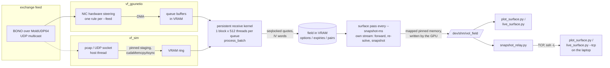

# Design

## Two binaries

They differ only in where frames come from.

**`vf_gpunetio` - NIC -> VRAM (DOCA GPUNetIO).** The NIC's hardware steering
sends the BONO multicast groups into packet buffers in GPU memory, and a
persistent kernel (one block per receive queue) parses them in place. No CPU
thread is on the data path. Needs a ConnectX-6 Dx or newer, so it is **built
and compile-verified against DOCA 3.5, not yet run** - nobody here has the
NIC.

**`vf_sim` - the same kernel body on any sm_75+ GPU.** A host thread replays a
pcap (or receives UDP datagrams) into a VRAM ring, and a persistent kernel of
the same shape runs the same per-frame code (`vf::dev::process_batch`, in
`include/vf/field_device.cuh`) over it. This is the path that runs and is
measured: the laptop (GTX 1650) and WATcloud (2080 Ti / 3090 / 4090).

## How a quote becomes a point on the surface



**Per batch** (up to 1024 frames, 512 threads, two frames each), in
`process_batch`:

1. Each thread checks Ethernet / IPv4 / UDP (one VLAN tag allowed), then walks
   its frame's MoldUDP64 blocks; every message gets the 64-bit sequence
   number `mold seq + index`.
2. **Pass 1** - Timestamp (`T`, folded into the feed clock with `atomicMax`),
   System Event, and the Options Directory (`D`), which claims slots in three
   lock-free open-addressing tables: options by ID, expiries by
   (underlying, YYMMDD), strike pairs by (expiry, strike). Only `--underlying`
   symbols are mapped.
3. `__syncthreads()` - so a directory entry and a quote for it in the same
   batch always apply in that order.
4. **Pass 2** - quotes (`q Q b a B A`), Trading Action (`H`), Security Open
   (`O`). A quote takes its option's seqlock with a CAS spin, applies each side
   only if its message sequence is newer than the one stored for that side,
   and releases. A newer quote that got there first, or an A/B-feed duplicate,
   simply applies nothing (counted as *stale*). The thread then solves the IV
   - outside the lock - if the option is live, two-sided, the expiry has a
   forward, and the option is out of the money, and publishes it as a 64-bit
   word `quote version << 32 | float IV` with a CAS that never replaces a
   newer version.

**Every `--snapshot-ms`** the host launches the surface pass on a second,
non-blocking stream while the receive kernel keeps running:

1. *forward* - one block per expiry: the parity forward
   `K + e^{rT}(C - P)`, median over the 5 pairs with the smallest `|C - P|`,
   reading each quote under its seqlock;
2. *resolve* - every option's IV re-solved against that forward (so IVs
   follow the forward, and ITM options get one too), published with the same
   version rule;
3. *snapshot* - three kernels on one stream: seqlock odd, write records,
   header and seqlock even with `__threadfence_system()`, into pinned shared
   memory registered with `cudaHostRegisterMapped`.

Readers (`tools/vfsnap.py`) copy between two equal, even seqlock reads.

## The math

`include/vf/black.hpp`, `double`, host and device: Black-76 on the forward;
implied vol from the out-of-the-money side's time value with a Corrado-Miller
(else Brenner-Subrahmanyam) start and bracketed Newton with a bisection
fallback, NaN when the price is outside the no-arbitrage bounds or a side is
missing. Time to expiry runs to 16:00 ET on the expiry date from the feed
clock, floored at one minute; `--date` and `--rate` are inputs. The surface
uses OTM options only: puts below the forward, calls above.

## Design notes and deviations

* **H and O are applied in pass 2, not pass 1.** A Trading Action racing a
  Directory message for the same option in one batch could hit the option
  before it existed; pass 2 runs after the barrier, like the quotes.
* **On-tick IV is solved for the OTM side only.** Deep-ITM mids at or below
  intrinsic are frequent (wide spreads, penny ticks) and their IVs are not
  used by the surface; solving them on every tick produced ~5% "failures". The
  surface pass still re-solves every option, ITM included, each snapshot.
* **Options start halted** until a Trading Action `H 'T'` releases them:
  the spec sends one per option in the pre-open spin and says an option
  missing from it is to be treated as halted (section 4.4). An option halted
  mid-day shows NaN.
* **The surface kernels are loaded before the persistent kernel starts.**
  With CUDA's lazy module loading, the first launch of a not-yet-loaded kernel
  waits for the device to idle - which a persistent kernel never does; the
  first surface pass then stalled until the run ended. `field_create` forces
  the load with `cudaFuncGetAttributes`.
* **Spec errata** in the v3.3 Appendix A, where `tests/test_bono.cpp`
  follows the message tables: Example 3 is 39 bytes (it predates the MPV
  field; the test appends one) and its prose says expiry day 21 where the
  byte is 22; Example 6's prose timestamp is off by one; Example 8 is an ask,
  not a bid; Examples 8 and 10 give wrong byte ranges.
* `vf_gpunetio`'s receive loop reads the exit flag once per block per
  iteration (thread 0, then a barrier), so no block can split between leaving
  and DOCA's block-scope receive.

## Limitations

* `vf_gpunetio` is compile-verified only.
* sm_75 is the floor (CAS-spin seqlock, `__nanosleep`, `%globaltimer`).
* No gap recovery (Glimpse / retransmission) - a gap shows only as the max
  sequence; trades are counted, not used; no SVI or other smoothing of the
  surface.
* IVs are European Black-76 on the parity forward; for American equity
  options the early-exercise premium biases deep-ITM IVs (the surface avoids
  them by using OTM options).
* `check_surface.py` compares against a single truth step; it is not meant
  for `--loop` runs.
* Table capacities are compile-time (65,536 options, 256 expiries, 32,768
  pairs, 8 underlyings); a full table counts an overflow and refuses inserts.

## Layout

```
include/vf/        common, net, moldudp64, bono, black (math), field (tables, counters),
                   field_device.cuh (process_batch), snapshot (shm layout), cli, config, run,
                   gpunetio (public API of the NIC path)
src/field/         field.cu (tables, surface pass), shm.cpp, loop.cpp (run loop, status),
                   report.cpp, cli.cpp, common.cpp
src/sim/           vf_sim: pcap reader, pcap / UDP sources, VRAM rings, sim_kernel.cu
src/gpunetio/      vf_gpunetio: setup.cpp (DOCA), receive_kernel.cu, main_gpunetio.cpp
tests/             test_bono (Appendix A + framing), test_black, test_field (GPU)
tools/             bono_gen, plot_surface, live_surface (+ .qml), check_surface, snapshot_relay,
                   replay_pcap, vfsnap
scripts/           doca-build.sh, hw-preflight.sh, watcloud/{env.sh, job.sbatch}
cmake/             vf_cuda.cmake (arch floor), vf_doca.cmake
```
